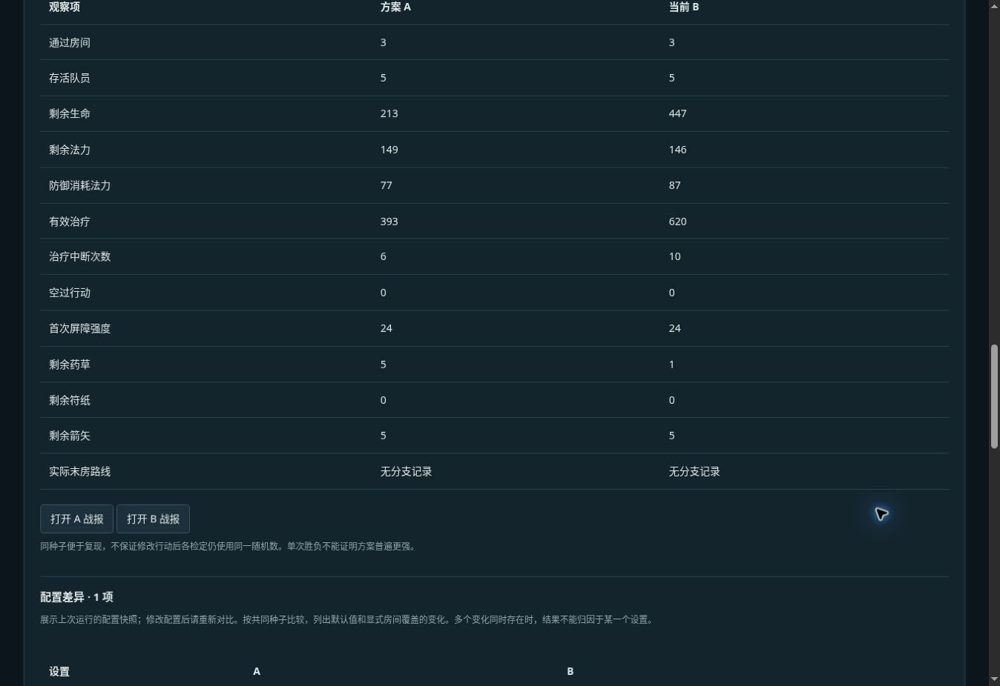

# v0.20 治疗优先级与取舍

本轮把治疗诊断转化成玩家能配置、能复现的战术选择，保持原创规则而非宣称复刻 WoD。

## 规则

治疗策略增加 `priority`：`lowest`（最低生命比例）和 `self_first`（自身达阈值时优先自保）。默认仍为最低比例。

候选必须同阵营、存活、受伤且在治疗范围内。优先自保仅在自己属于候选且生命比例不高于阈值时选自己，否则仍选范围内最低比例目标。范围、阈值、法力和药草要求均不绕过；药剂检查仍先于自动治疗，治疗仍须等自身普通行动机会，不保证能在受击倒地前自救。

选人函数由执行引擎和战报诊断共用，诊断 schema 2 记录 selectionPolicy 和实际候选。治疗可按房间覆盖，比较页展示优先级变化。

## 复现

守灯归途总览点击“载入最低比例 / 优先自保对照”，然后在战术实验点击对比。A 为原始队形最低比例，B 仅改变露弥的优先级，种子为 1，其他配置完全一致。入口会替换当前方案和已保存 A。

种子 1 两者都通关、存活 5 人：A 失去药师，B 保住药师却失去吟游者。A/B 有效治疗分别为 393/620，剩余药草 5/1，总剩余生命 213/447。因此更多治疗和治疗者存活不等于全队无损。

## 固定种子样本

脚本 `node scripts/sample-v20.mjs`，两种队形 × 两种优先级 × 种子 1–32，共 128 次。产物 `dist/samples-v20.json`。以下是样本计数，不是总体胜率估计。

|队形|优先级|通关|全员归航|药师存活|
|---|---|---:|---:|---:|
|原始|最低比例|17/32|0/32|5/32|
|原始|优先自保|19/32|1/32|13/32|
|分房保护|最低比例|31/32|20/32|31/32|
|分房保护|优先自保|31/32|20/32|31/32|

分房保护下以上三项计数相同，不能推断两种策略的所有逐事件结果相同。优先级是取舍，不代替站位、防御和资源规划。

## 兼容与验证

配置版本升至 0.20.0，规则标记为 original-wod-inspired-0.20.0。迁移旧 0.14 配置时，缺失 priority 按 lowest 处理；已保存 A 同样迁移。历史样本保留生成时规则版本，不冒充新规则产物。

`node --test tests/*.test.mjs`：134 项通过。新增检查覆盖候选范围/存活/阈值、旧配置默认值、无资源阻断、房间覆盖隔离、单项配置差异、实际治疗与诊断目标一致、确定性复现。浏览器验证策略下拉框、房间覆盖和 A/B 入口。

## 边界与下一阶段

本轮未新增美术资产或在线 AI 服务。仍为前端本地模拟，不含账号或多人。

下一阶段应优先做可玩的新遭遇：让玩家依据明确敌情，在有限资源下选择救护、控场和输出方案；为关键遭遇配事件画面，并通过完整远征而非继续堆叠诊断面板验证体验。
