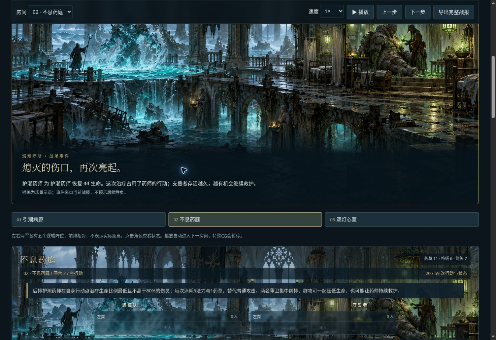

# v0.21 溺潮疗所

## 可玩内容

新增独立三房路线：引潮病廊、不息药庭、双灯心室。36份玩家补给，每房最多24回合，生命和法力连续继承，无回廊机关和五回合封路。

首房学习击杀司祭切断召唤；次房面对同阵营最低生命比例治疗；末房司祭中央、药师后排，要求选择集火顺序。召唤、治疗、资源与行动规则沿用引擎，敌方不使用特殊免费行动。每房敌方补给独立初始化各60份，司祭和药师初始80法力，每回合自然回复1。召唤消耗10法力/1符纸，治疗消耗5法力/1药草。

三套方案：正面推进、切断支援、集火＋救护。前两种只改变射手/潮术师各房间的目标，共6组房间覆盖，技能、装备、训练、物资相同；这是目标策略对照，不声称仅一个配置字段变化。第三种另改变药师治疗专修、训练、80%阈值。

## 表现

新原创AI场景用于路线总览、战场与事件示意。战报只读投影在每房每位支援者第一次实际召唤/治疗、以及支援者倒下时显示事件插画，并暂停自动播放。支援被击倒的文字不会提前出现在此前回放中；完整战报关键事件列表仍可直接跳转。场景是示意图，不按每次实际目标动态生图。新增治疗/召唤支援身份标识和敌情治疗说明。

## 样本与限制

`node scripts/sample-v21.mjs`：三种方案 × 种子1–32，共96次。产物 `dist/samples-v21.json`。

|方案|通关|全员归航|平均总回合|平均敌方召唤|
|---|---:|---:|---:|---:|
|正面|32/32|32/32|18.90625|10.21875|
|集火|32/32|32/32|13.0625|2.59375|
|集火＋救护|32/32|32/32|13.03125|2.5|

当前作为机制入门，不是高难度挑战。样本不足以证明任意配置都能通关，或集火在每个房间总是更快。

种子1正面/集火：三房回合4/4/11与3/5/7；敌方召唤11/3次，治疗9/7次。第二房集火反而慢1回合。最终两者均6人存活，生命619/640、法力215/201，符纸和箭矢均耗尽。不能把总回合减少误称为所有资源全面节省。

## 验证

140项测试通过，包括新路线计划合法性、仅目标差异、敌方治疗只作用同阵营且与诊断一致、主人死亡后召唤消散、事件首次触发与只读性、身份标识、种子复现。最初消散测试误用了已清完潮卫的正面样本，修正为确有存活潮卫的集火样本后通过；未为通过测试修改引擎规则。

浏览器验证载入三房路线、集火方案通关、首次药师治疗插画、A/B六组房间目标差异。预览截图：



## 版本与后续

内容/规则标记 original-wod-inspired-0.21.0；配置结构仍为0.20.0，无新增配置字段。保持既有浏览器配置和旧路线。纯前端模拟；未增加账号、多人、掉落成长或在线生图。

下一阶段可围绕疗所加入有取舍的可选目标，例如在完成清场之外保留限定资源，或提供不同支援组合；先让玩家试玩确认目标选择是否足够清楚，再提高难度。避免仅增加数值而削弱敌情可读性。

## 图像来源与提示词

使用内置 imagegen 生成；项目资产路径 `/workspace/sites/sunken-abbey/dist/assets/drowned-infirmary-v21.png`。原图生成后直接复制，未替换旧资产。

```text
Use case: stylized-concept. Asset type: wide dark fantasy tactical RPG encounter background and chapter illustration. Primary request: the Drowned Infirmary inside a ruined coastal abbey, a tide summoner and an enemy herbalist sustaining stone guardians. A vast flooded gothic infirmary, broken beds and stone walkways, pale green healing lanterns on the right, a circular cyan summoning pool on the left, one distant hooded summoner raising a water sentinel and one distant masked herbalist with glowing herbs beside a wounded stone guardian. Painterly premium dark fantasy concept art, subdued deep teal and oxidized bronze, cinematic volumetric light, mysterious rather than horror. Wide landscape composition, architecture dominates, foreground open dark stone for game tokens, distinct readable silhouettes in the middle distance. No UI, no text, no logos, no watermark. This is an original game setting.
```

