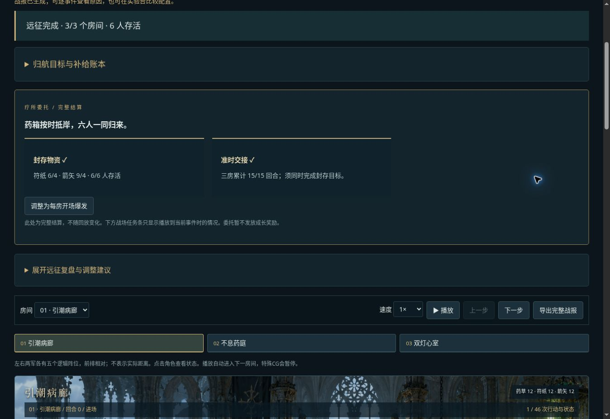

# v0.22 封存物资与准时交接

## 玩家目标

在溺潮疗所添加两个可选目标：

- 封存物资完整归航：三房清场、六名正式成员存活，剩余符纸至少4、箭矢至少4。
- 准时交接：同时完成以上目标，三房战斗回合总数不超过15。

不达标不会改变原本通关判定，不扣额外物资、不锁定库存、不提供隐藏加成。当前不发放成长奖励，不把库存带入下一局。未到达房间不按零回合通关处理；失败即不可达成委托。

## 三套方案

持续集火沿用v0.21集火方案。开场爆发把射手破甲重箭、潮术师凝潮长枪改为每房一次，随后执行原备用技能；学者屏障也改为每房一次。全程低耗仅保留穿石箭/微光，仍用每房一次屏障。目标、初始物资、其他配置一致。

开场与持续的比较同时包含攻击频率和屏障频率，不作单字段归因。每房一次屏障不会覆盖整场战斗，需考虑防护空窗。用户仍可在队伍配置中自行修改。

## 展示与数据

出发页列出委托；完整结算独立展示两个目标。战场任务条只读取当前事件的单位状态、补给和已发生房间回合，不读取最终库存预测结果。显示“待归航/待交接”或明确已无法满足，最终第三房胜利才显示达成。

这是只读任务与方案扩展，不改变模拟器公式、RNG或事件流；引擎规则仍为 original-wod-inspired-0.21.0，配置仍0.20.0，界面版本0.22。

## 固定样本

`node scripts/sample-v22.mjs`：三种方案×32个共同种子，产物 `dist/samples-v22.json`。

|方案|通关|物资完整归航|准时交接|平均总回合|
|---|---:|---:|---:|---:|
|持续集火|32/32|0/32|0/32|13.0625|
|开场爆发|32/32|32/32|29/32|14.25|
|全程低耗|32/32|32/32|13/32|15.84375|

种子1开场爆发：4/5/6回合，共15；6人存活，剩余10药草/6符纸/9箭矢。固定种子样本不代表总体成功概率，也不是任意配装下的最优解证明。

## 验证

144项测试通过；新增验证每房一次技能执行次数、目标边界（4份、15回合包含等号）、未清场和减员不得达标、回放不读取未来库存/回合、旧路线保持3个原目标。浏览器验证任务入口、开场方案通关、完整结算达成、回放起点仍为待交接且库存12/12。

本轮复用v0.21场景，没有新增AI生成资产。

