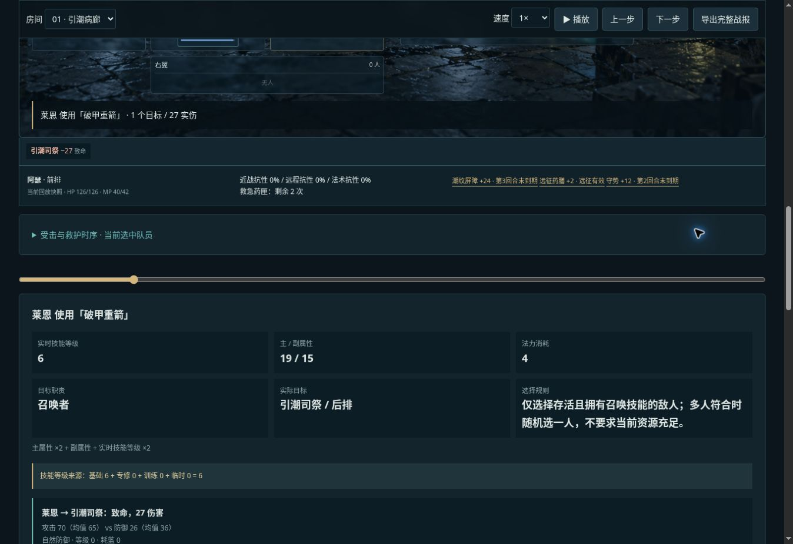

# v0.23 职责目标与指令回退

## 规则

远程和法术的单体攻击可以把目标写为治疗者（healer）或召唤者（summoner）。候选须为存活敌人且分别拥有 heal 或 sentinel 技能，不受阵位影响；不检查对方剩余法力、材料或是否启用自动治疗，不预测下一步动作。多人符合时按战斗随机流洗牌后取一人。

群攻、近战、辅助和召唤技能不能使用职责目标；编辑器不提供非法选项，导入校验同样拒绝。切换到不支持的技能时目标回退前排。

无符合目标时记录跳过，不扣法力/材料，不消耗行动，尝试下一条指令；资源或装备不足也按原有规则回退。所有指令仍使用既有游标：从当前指令继续，一圈最多检查现有指令数量，换房重置。不是每次行动重新评估第一条的条件脚本。

## 可玩入口

溺潮疗所增加“先治疗者→召唤者”和“先召唤者→治疗者”。两名输出采用两条强力职责指令和一条低耗前排备用，清除此前的房间输出覆盖。A固定为召唤者优先，B为当前方案。玩家也可在队伍配置为单个角色、单个房间编辑。

## 可解释性

职责施放战报记录 targetPolicy：请求职责、选择规则、实际目标ID/名字/阵位。UI显示同样信息。无目标跳过原因也指出缺少哪种职责。旧阵位配置不加入新字段、不额外抽取随机数。

## 样本

`node scripts/sample-v23.mjs`，种子1–32，两个顺序，共64次。产物 `dist/samples-v23.json`。

|顺序|通关/全员|平均回合|平均敌方治疗|平均敌方召唤|
|---|---:|---:|---:|---:|
|治疗者优先|32/32|12.9375|2.5|3.6875|
|召唤者优先|32/32|12.9375|4.96875|2.5|

两种顺序在本样本里总回合平均值恰好一致，不能据此认为逐事件结果相同或某一顺序普遍最优。职责策略也不保证封存物资目标。

## 兼容与验证

配置0.23.0、规则original-wod-inspired-0.23.0；0.20.0和既有旧版本经迁移读取，缺失的新能力不会自动写入旧指令。历史样本保留原规则标记。

148项测试通过。新增验证：跨阵位选中、只选存活敌人、近战/群攻拒绝、免费跳过与下一指令、实际记录一致、移动敌人阵位后仍能选中、确定性和输入不变。既有路线回归继续通过。

浏览器验证职责下拉框、改为齐射后无职责选项、改回重箭可选治疗者、完整通关和实际目标战报。图示：首房没有治疗者，莱恩免费跳过第一条后，以第二条选中后排引潮司祭。

本轮复用现有场景图，无新增AI资产。下一步应围绕队员构筑与更长远征内容扩展，再考虑角色成长，而不是把职责选择误扩成无约束脚本系统。
