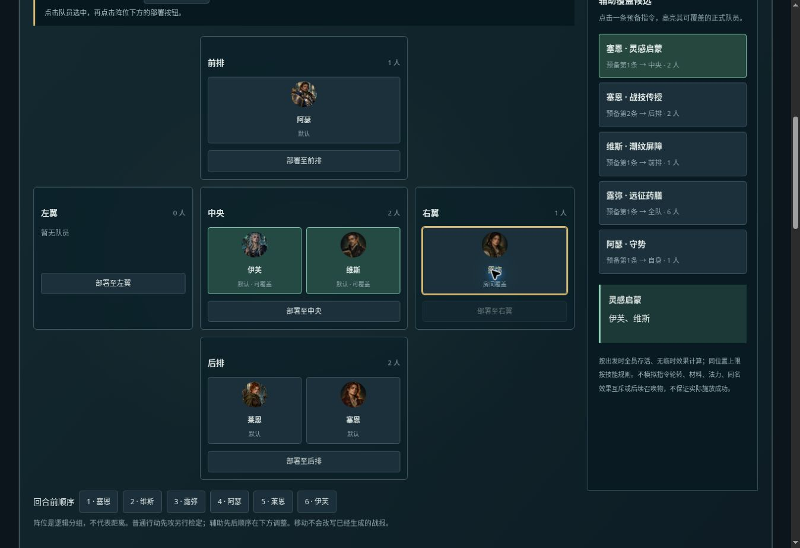

# v0.24 可视化阵位部署

在“远征准备→队伍配置”顶部新增部署桌，沿用既有五个逻辑阵位与六名队员立绘。先点击队员，再点击阵位部署按钮；也可从预备顺序条选中队员。支持键盘按钮操作，不依赖拖拽。

编辑范围可切换默认方案或具体房间，与原有配置范围同步。房间部署只写该英雄该房间的pos覆盖，保留其他英雄和其他覆盖字段。恢复默认站位删除该项覆盖，原有指令和防御配置不变。默认站位修改不会覆盖已单独设置的房间。

右侧列出当前范围所有辅助预备指令，按回合前队员顺序排列，注明各自指令行号。点击后高亮可覆盖的正式队员，按引擎原有辅助选人规则计算（全队、自身、位置及人数上限）。这不是回合模拟：假定出发时六人存活，无临时效果；不判断资源、轮转、同名效果互斥、不包含后续召唤物，也不预测成功施放或增益数值。超过技能人数上限时沿用引擎正式队员顺序，不改为随机。

示例：守灯原始队形第二房，露弥中央→右翼后，灵感启蒙候选从伊芙/维斯/露弥改为伊芙/维斯。启蒙的目标仍为中央，不会偷偷随队员移动。第三房仍为默认中央。

## 验证

152项测试通过。新增测试覆盖部署不修改输入、房间隔离、保留已有覆盖、位置合法性、辅助候选随站位变化、人数上限、自身与全队、房间预备顺序、预览不改变模拟结果。另验证零符纸时仍能显示屏障覆盖候选，但实际战斗不施放，确保候选不被混同于成功预测。

浏览器验证选择队员、点击部署、覆盖高亮、切换房间、恢复继承；实际启动远征后第二房战场快照显示露弥位于右翼。截图：

本轮界面版本0.24，配置及战斗规则仍为0.23，无新的数据迁移、数值调整或AI资产生成。复用原有角色立绘；窄屏将五阵位改为纵向排列以保证按钮可操作。
